# Deadlock Bangladesh — PUG Platform
Native live drafting, match tracking, leaderboards and Discord integration for a Deadlock PUG community.

> **This project is vibe coded.** It was built almost entirely with AI coding agents for the Bangladeshi Deadlock
> community, and it runs real PUG nights. It's yours to take: fork it, rename it, point it at your own community
> and build on it. There's no support promise, but the code, tests and docs are all here.
> Released under the [MIT License](LICENSE).

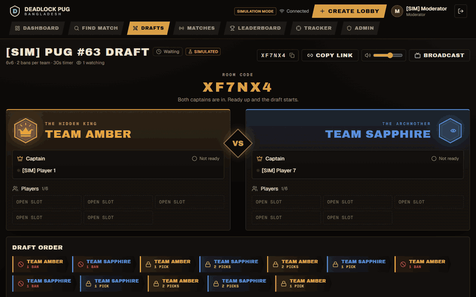

*A simulated 6v6 draft at 3× speed: bans, alternating picks, a shared timer and the final lineup.*

## Features

**Live hero draft.** Captains ban and pick in real time over WebSockets, with a turn timer, configurable formats
(6v6, 4v4, 2v2), ban phases, mirror picks, spectators and a broadcast view for streams.

| Drafting | Draft complete |
|---|---|
| 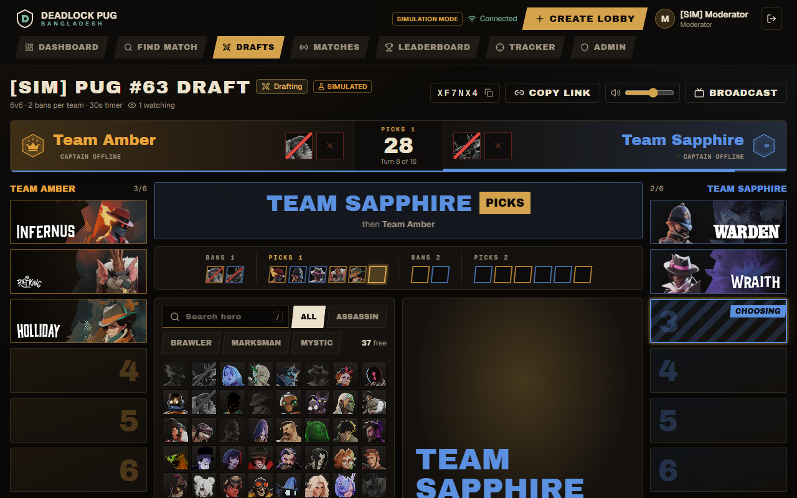 | 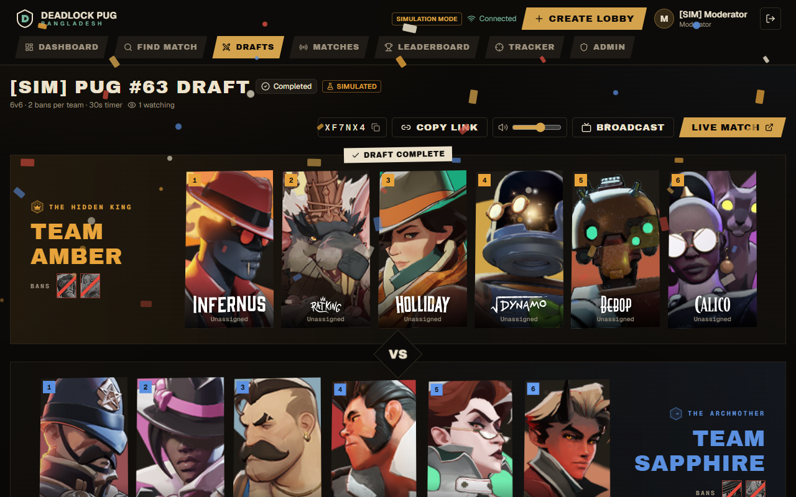 |

**Lobbies and matchmaking.** Create a PUG lobby with invite links for each captain, players and viewers, or join the
6v6 queue. When it fills, everyone readies up and the two highest-rated players become captains.

| Lobby | Queue |
|---|---|
| 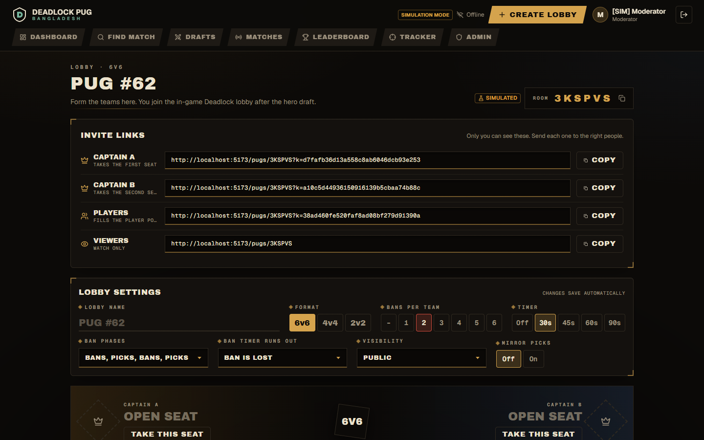 | 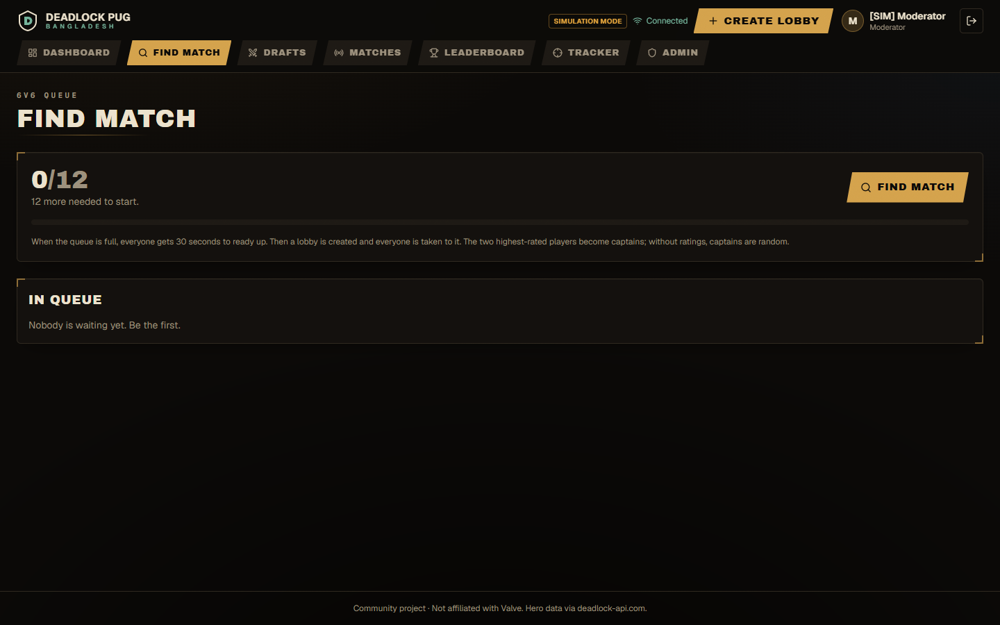 |

**Match tracking.** Finished games are matched to their draft through the Deadlock API (or a moderator enters the
Match ID), and full scoreboards are stored: K/D/A, souls, damage, objectives, healing and points per player.

| Match page | Match history |
|---|---|
| 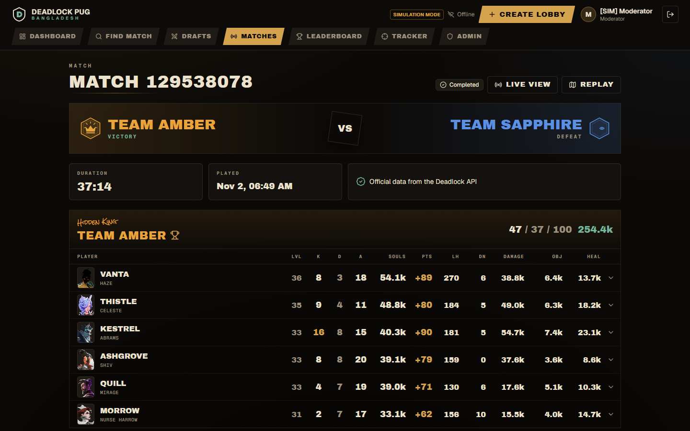 | 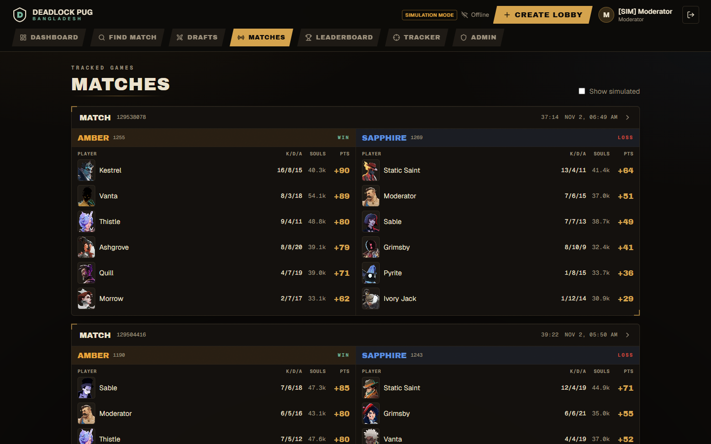 |

**Leaderboard and player profiles.** Seasons, PUG points, a calibrated rating, recent form, most-played heroes and
each player's in-game Deadlock rank once they link Steam.

| Leaderboard | Player profile |
|---|---|
| 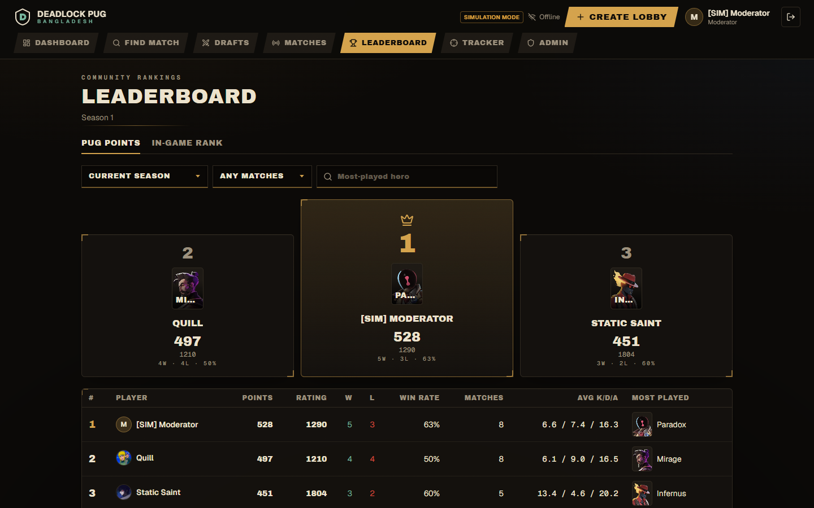 | 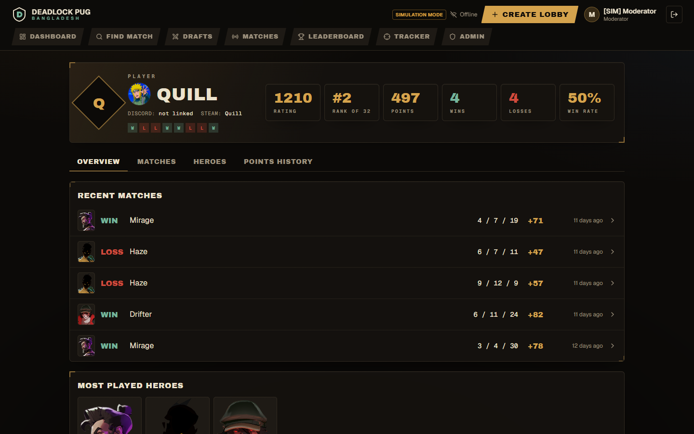 |

**Also included:** Discord login and bot notifications, a moderator match tracker, an admin panel, match replays, and a
**simulation mode** that runs a whole PUG (draft → live match → result → leaderboard) with fake players, so you can try
everything without a Deadlock lobby.

| Home | Moderator tracker |
|---|---|
| 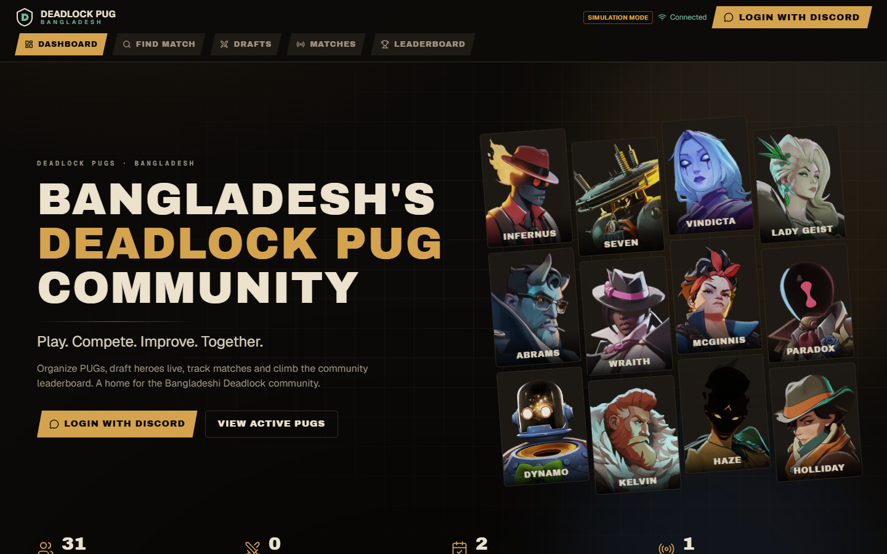 | 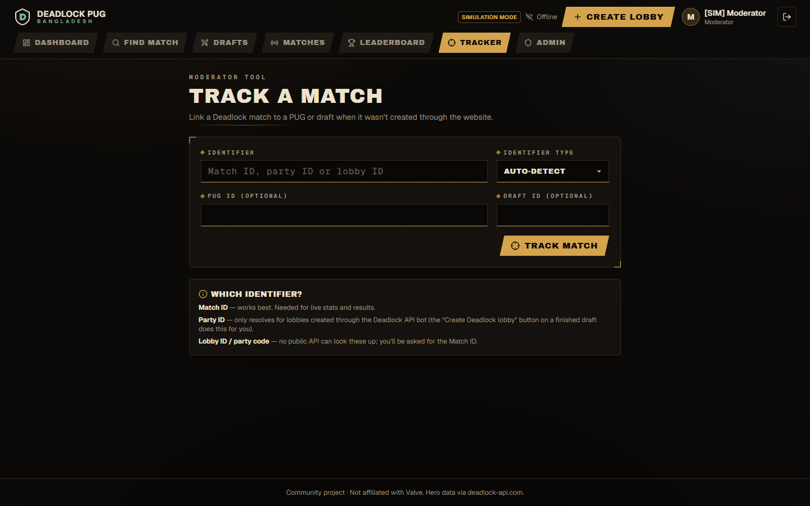 |

*All screenshots use demo data with made-up player names.*

## Make it your own
1. Fork the repo and follow **Local development** below with `SIMULATION_MODE=true`: you get a working site with fake players in a few minutes.
2. Swap the branding (name, colours, copy) — the design system lives in [`docs/UI.md`](docs/UI.md).
3. Create a Discord application for login and the bot, then deploy with Docker (see **Production**).
4. Building with an AI agent too? Point it at [`AGENTS.md`](AGENTS.md) first.

Read first: [`docs/API_FEASIBILITY.md`](docs/API_FEASIBILITY.md) — what the Deadlock APIs can and cannot do.
Contributing (people or AI agents): [`AGENTS.md`](AGENTS.md). Design system: [`docs/UI.md`](docs/UI.md).

## Stack
Vue 3 + Vite + Tailwind + Pinia · Fastify + WebSocket · PostgreSQL/Prisma · Redis · discord.js. Modular monolith (`apps/server`, `apps/web`).

## Local development
```bash
npm install
cp .env.example apps/server/.env   # set SESSION_SECRET, DATABASE_URL, REDIS_URL, SIMULATION_MODE=true
cd apps/server && npx prisma migrate deploy && cd ../..
npm run dev                        # api :3001, web :5173 (proxied)
```
With `SIMULATION_MODE=true`, use the development login and **Run simulated PUG** on the dashboard: it drives a full
PUG → draft → live match → result → leaderboard cycle. All simulated rows are flagged and badged in the UI.

## A PUG night, end to end
1. **Create lobby** (Drafts) → share the 6-letter code. Captains take seats and ready up; players join their team.
2. Ban and pick. When the draft is complete, captains assign each hero to a player.
3. A captain clicks **Create Deadlock lobby**. Players join in Deadlock with the party code shown (Play → Custom), pick their assigned heroes and start within 15 minutes.
4. The website detects the match (webhook on a public HTTPS deployment, otherwise polling every 15s) and links it to the draft and PUG.
5. Live stats appear if deadlock-api provides them for the match; otherwise a moderator submits the result on the match page.
6. Ratings, leaderboard and Discord update.

If the bot can't be used (rate limit, outage), create the lobby in-game and a moderator enters the Match ID in **Tracker**.

## Tests
```bash
npm test
```
Optional database integration tests: `TEST_DATABASE_URL=postgresql://… npm test` (use a disposable, migrated database).

Covers the draft engine (turn order, pick/ban validation, timers, pause/resume, corrections), concurrency, WS broadcast/reconnect,
identifier classification, match ID resolution (mocked API), live-event normalization/dedupe, Elo, idempotent results, permissions.

## Production (Docker)
```bash
cp .env.example .env   # fill in
docker compose up -d --build              # add --profile live to run deadlock live-events locally
```
Caddy terminates TLS; the app container serves the API, WebSocket and the website. Health: `GET /api/health`.

Updating: `git pull && docker compose up -d --build` (the website ships inside the image, so nothing else to clear).
